# 🛒 Awesome Checkout Platform

  <strong>Curated guide to cutting-edge Hosted Checkout Pages, Payment Orchestration Engines, One-Click Flows & Composable Commerce Stacks.</strong>

  
  
  
  
  

  <strong>🌟 Star this repository if you find it helpful! 🌟</strong>

---

## 📌 Overview & SEO Summary

Welcome to the **Awesome Checkout Platform** directory—an authoritative, production-tested benchmark tracking notable **SaaS hosted checkout solutions**, **payment orchestration layers**, and **open-source headless commerce frameworks**.

Modern digital commerce depends on frictionless conversion flows. These tools enable software engineers, e-commerce merchants, and enterprise architects to accept global payments with minimal friction—spanning fully hosted PCI-DSS compliant checkout pages (handling dynamic payment method rendering, local payment rails, and 1-click accelerated wallets) to self-hosted composable commerce engines where checkout business logic is fully customized.

### 🔍 Key Search Topics & Index Keywords
- **Hosted Checkout & UI**: Stripe Checkout, Shopify Shop Pay, Adyen Drop-in, Square Online Checkout, PayPal Commerce.
- **Payment Orchestration**: Smart routing, multi-acquirer fallbacks, authorization optimization, unified payment APIs.
- **Composable / Headless Commerce Checkouts**: Medusa.js, Saleor GraphQL, Vendure TypeScript, Sylius Symfony, Spree Commerce, Bagisto Laravel.
- **Alternative & Crypto Rails**: BTCPay Server self-hosted Bitcoin/Lightning payments, Kill Bill subscription billing.

---

## 📑 Table of Contents

- [📊 Sector Overview & Market Dynamics](#-sector-overview--market-dynamics)
- [☁️ SaaS / Hosted Checkout Platforms](#️-saas--hosted-checkout-platforms)
- [🔓 Open-Source GitHub Projects](#-open-source-github-projects)
- [💡 Architectural Best Practices](#-architectural-best-practices)
- [📈 Star History](#-star-history)
- [💖 Support & Sponsorship](#-support--sponsorship)
- [🤝 How to Contribute](#-how-to-contribute)
- [⚠️ Disclaimer & Compliance](#️-disclaimer--compliance)

---

## 📊 Sector Overview & Market Dynamics

The global payment gateway and checkout platform market is estimated at **$35B – $58B in 2026** and projected to surpass **$240B+ by the mid-2030s** (growing at an estimated 14%–22% CAGR). The sector is **moderately fragmented yet increasingly concentrated around dominant ecosystem winners**—where top players like Amazon, Shopify, Stripe, PayPal, and Adyen capture massive transaction volumes, while specialized and independent one-click checkout providers face steep network-effect barriers and margin pressure.

---

## ☁️ SaaS / Hosted Checkout Platforms

The following SaaS platforms provide hosted checkout pages, built-in PCI compliance, and multi-currency payment method rendering. Entries are ranked in descending order by **Company Size (Valuation / Market Capitalization)**:

| 🏷️ Platform | 🏢 Company Size (Valuation / Revenue) | 💳 Starting Pricing Tier | 🎁 Free Tier Limits / Free Trial | 🎯 Best For & Overview |
| :--- | :--- | :--- | :--- | :--- |
| **[Amazon Pay](https://pay.amazon.com/)** | **~$2.68T Market Cap** (~$716.9B annual revenue) | 2.9% + $0.30 per domestic web/mobile transaction ($0 setup/monthly fees) | **No Free Trial**: Unlimited sandbox test environment included; live processing has no free transaction tier (fees apply on successful live transactions). | Merchants seeking trusted 1-click checkout leveraging Amazon accounts and buyer credentials. |
| **[Shopify Checkout](https://www.shopify.com/)** | **~$220B Market Cap** (~$8.9B annual revenue) | Basic plan starting at **$39/month** (+ 2.9% + $0.30 per online transaction with Shopify Payments) | **3-Day Free Trial** (then $1/month promo for 3 months): Unlimited store build/admin testing; live checkout is locked in password-protected mode until a paid plan is selected. | Merchants wanting a turn-key managed checkout with the Shop Pay network without PCI burdens. |
| **[Stripe Checkout](https://stripe.com/payments/checkout)** | **~$159B Private Valuation** (~$4.2B+ net revenue) | **2.9% + $0.30** per successful card charge (Pay-as-you-go, no monthly fee) | **No Live Free Tier**: Free perpetual Sandbox/Test Mode (full API & UI simulator, up to 730-day trial simulation); live mode has no free transaction allotment. | Developers wanting the fastest integration to a conversion-optimized, PCI-compliant hosted checkout. |
| **[PayPal Checkout](https://www.paypal.com/)** | **~$46B Market Cap** (~$31.8B annual revenue) | **3.49% + $0.49** per PayPal/Venmo checkout transaction (**2.99% + $0.49** for standard card processing) | **No Free Tier**: Free perpetual developer sandbox access; live checkout charges per processed order with zero free allowance. | Merchants looking for immediate access to 400M+ active PayPal and Venmo wallet users. |
| **[Square Checkout](https://squareup.com/)** | **~$45B Market Cap** (Parent Block; ~$24.1B annual revenue) | **$0/month** software fee with **3.3% + $0.30** per online transaction (or **2.9% + $0.30** via Square Online APIs / $49/mo Plus plan) | **Free-Forever Plan**: Unlimited products, full POS sync, and online payment links; limited to basic store templates, standard reporting, and 3.3% + 30¢ processing rate. | Omnichannel merchants unifying online checkout and in-person POS sales with zero upfront monthly cost. |
| **[Adyen Checkout](https://www.adyen.com/)** | **~$30B Market Cap** (~€1.9B net revenue) | Interchange++ starting from **$0.12 fixed fee + 0.40%–0.60% markup** per transaction (typically €100–€500/mo minimum volume) | **No Free Tier**: Free test/sandbox environment for enterprise integration; live processing requires approved commercial contract with monthly minimums. | Global enterprises requiring unified cross-channel online/in-store processing and international acquiring. |
| **[Checkout.com](https://www.checkout.com/)** | **~$12B Valuation** (~$500M+ revenue) | Interchange++ custom quote (starting base markup of **~0.25%–0.50% + $0.05–$0.10** per transaction with zero monthly gateway fee) | **No Free Tier**: Dedicated sandbox testing environment; live transactions require merchant underwriting and commercial contract. | High-volume merchants and modern fintechs requiring direct acquiring relationships and granular payment APIs. |
| **[Klarna Checkout](https://www.klarna.com/)** | **~$4.8B Valuation / Market Cap** (~$2.8B revenue) | **5.99% + $0.30** per transaction for standard BNPL (or ~2.99% + $0.30 for Pay Now; scales to 3.29% + $0.30 for high volume) | **No Free Tier**: Playground/test credentials available for integration; zero free transactions on live production orders. | Merchants targeting younger demographics seeking seamless embedded Buy Now Pay Later (Pay in 4 / 30). |
| **[Bolt](https://www.bolt.com/)** | **~$300M Valuation** (down from $11B peak; ~$30M revenue) | Baseline starting rate of **2.9% + $0.30** per transaction or custom markup over existing processor gateway | **No Free Tier**: Sandbox developer portal for testing; live deployment requires enterprise agreement. | Merchants exploring standalone alternative 1-click networks aware of ongoing platform volatility. |
| **[Fast](https://fast.co/)** | **$0 / Defunct** (Shut down April 2022 after raising $125M; peaked at $600K ARR) | Defunct (**N/A**; previously charged ~2.9% + $0.30) | **Defunct**: Zero active tiers or trials. Retained as historical case study on unsustainable wallet subsidies. | Historical reference only; do not build on this platform. |

---

## 🔓 Open-Source GitHub Projects

Open-source checkout options provide **payment orchestration infrastructure**, **composable commerce APIs**, or **complete self-hosted checkout storefronts**. Repositories below are sorted in descending order by **GitHub Stars_Count**:

- **[Hyperswitch](https://github.com/juspay/hyperswitch)**  🦀
  
  **Open-source payment orchestration platform** (Apache 2.0) — **the most widely starred open-source infrastructure for the payment layer beneath checkout**. 
  - **Features**: Unified orchestration across 100+ processors and networks; dynamic routing and smart retries to maximize authorization rates; independent card vault, reconciliation, cost observability, and checkout APM widgets.
  - **Tech Stack**: Rust (high-performance backend), TypeScript / React.
  - **Deploy**: Self-hosted (Docker, Kubernetes) or Hyperswitch Cloud.
  - **Trade-off**: Orchestration layer, not a storefront checkout UI—it routes transactions and manages processor connections, but you still implement your frontend checkout experience.
  - **Best for**: Merchants seeking to eliminate payment processor lock-in, decrease transaction fees, and own routing logic without building from scratch.

- **[Medusa](https://github.com/medusajs/medusa)**  ⚡
  
  **Open-source headless commerce platform** (MIT for core) — **a modular framework where checkout logic is completely yours to own and customize**.
  - **Features**: Composable architecture with decoupled cart, customer, payment, and fulfillment modules; API-first; payment step flow includes provider discovery, payment collections, and multi-session initialization via SDK.
  - **Tech Stack**: Node.js, TypeScript, PostgreSQL.
  - **Deploy**: Self-hosted or Medusa Cloud.
  - **Trade-off**: Not a turnkey checkout SaaS page—you construct the checkout UI and user flow in your Next.js/React storefront.
  - **Best for**: Engineers seeking complete architectural ownership of checkout and commerce business logic within a modern JavaScript/TypeScript stack.

- **[Bagisto](https://github.com/bagisto/bagisto)**  🛍️
  
  **Open-source Laravel eCommerce framework** (MIT) — **feature-rich complete commerce engine with built-in multi-step and one-page checkout flows**.
  - **Features**: Complete one-step checkout; multi-currency and multi-channel support out of the box; integrated PayPal, Stripe, and Cash on Delivery gateways; native mobile app API (REST & GraphQL).
  - **Tech Stack**: PHP 8.2+, Laravel 11/12, Vue.js, MySQL.
  - **Deploy**: Self-hosted (LAMP/LEMP, Docker).
  - **Trade-off**: Adopts the broader Laravel monolith stack; custom checkout UI customizations require familiarity with Blade/Vue templates.
  - **Best for**: Teams seeking a complete, customizable PHP/Laravel commerce platform with an operational checkout already included.

- **[Saleor](https://github.com/saleor/saleor)**  🌐
  
  **Open-source GraphQL-first headless commerce platform** (BSD-3-Clause) — **enterprise-grade composable framework featuring an expressive checkout API**.
  - **Features**: Comprehensive GraphQL API managing carts, checkouts, shipping lines, taxes, and payments; official TypeScript SDK with typed checkout helpers; official reference Next.js storefront checkout implementation.
  - **Tech Stack**: Python (Django), GraphQL, PostgreSQL.
  - **Deploy**: Self-hosted or Saleor Cloud.
  - **Trade-off**: Backend engine only—checkout UI must be integrated into your frontend web or mobile client.
  - **Best for**: Teams demanding a typed GraphQL API, strict performance guarantees, and fine-grained control over dynamic checkout mutations.

- **[Spree Commerce](https://github.com/spree/spree)**  💎
  
  **Open-source headless & multi-store eCommerce platform** (BSD-3-Clause) — **battle-tested commerce engine powering thousands of global checkouts**.
  - **Features**: Complete checkout state-machine (address, delivery, payment, confirm); multi-store, multi-currency, and omni-channel checkout natively; robust payment gateway integrations (Stripe, Braintree, PayPal, Adyen).
  - **Tech Stack**: Ruby on Rails, PostgreSQL / MySQL.
  - **Deploy**: Self-hosted (Heroku, AWS, Kubernetes).
  - **Trade-off**: Requires Ruby/Rails knowledge for deep backend customization.
  - **Best for**: Organizations requiring a battle-hardened checkout state machine with enterprise stability and active plugin ecosystem.

- **[Sylius](https://github.com/Sylius/Sylius)**  🦅
  
  **Open-source eCommerce framework for Symfony** (MIT) — **PHP framework engineered for ultimate flexibility and test-driven checkout design**.
  - **Features**: Configurable checkout state machine; tiered pricing, promotions, multi-warehouse shipping calculations; headless API-first architecture compatible with any frontend.
  - **Tech Stack**: PHP, Symfony, Doctrine, MySQL.
  - **Deploy**: Self-hosted.
  - **Trade-off**: High developer-centric learning curve; designed for tailored enterprise implementations rather than 5-minute setup.
  - **Best for**: PHP/Symfony engineers demanding total control over checkout business logic with rigorous unit test coverage.

- **[Vendure](https://github.com/vendure-ecommerce/vendure)**  🍁
  
  **Open-source headless commerce framework** (MIT) — **modern TypeScript-first commerce backend paired with high-performance checkout starters**.
  - **Features**: Clean GraphQL API; TanStack Start & Next.js storefront starters with built-in multi-step checkout; multi-currency, promo codes, shipping calculation, and extensible payment method handlers.
  - **Tech Stack**: Node.js, TypeScript, GraphQL, PostgreSQL / MySQL.
  - **Deploy**: Self-hosted (Docker, Node servers) or Vendure Cloud.
  - **Trade-off**: Checkout is client code you own and maintain; no third-party hosted page.
  - **Best for**: TypeScript developers seeking an intuitive developer experience with modular payment provider plugins.

- **[BTCPay Server](https://github.com/btcpayserver/btcpayserver)**  ⚡
  
  **Self-hosted, open-source cryptocurrency payment processor** (MIT) — **non-custodial checkout page for Bitcoin, Lightning Network, and altcoins**.
  - **Features**: Ready-to-use checkout UI supporting invoices, QR codes, and Lightning payments; zero processing fees and no middleman; automated settlement to your hardware wallet; e-commerce plugins for WooCommerce, Shopify, and custom APIs.
  - **Tech Stack**: C#, .NET, PostgreSQL.
  - **Deploy**: Self-hosted (Docker, LunaNode, Umbrel, Start9).
  - **Trade-off**: Dedicated to crypto/Bitcoin payments—does not process traditional Visa/Mastercard credit cards.
  - **Best for**: Merchants and developers requiring a sovereign, zero-fee crypto checkout without custodial counterparty risk.

- **[Kill Bill](https://github.com/killbill/killbill)**  💰
  
  **Open-source subscription billing and payments platform** (Apache 2.0) — **enterprise infrastructure for complex recurring checkouts and billing**.
  - **Features**: Multi-gateway payment routing; recurring billing engine, invoicing, dunning, and catalog management; integrates with Stripe, Adyen, PayPal, and Authorize.Net via plugins.
  - **Tech Stack**: Java, OSGi, MySQL / PostgreSQL.
  - **Deploy**: Self-hosted (Docker, AWS, Kubernetes).
  - **Trade-off**: Focuses on subscription logic, billing schedules, and backend gateway routing rather than customer-facing UI components.
  - **Best for**: SaaS companies and recurring revenue models requiring self-hosted subscription checkout infrastructure without SaaS rev-share.

- **[Solidus](https://github.com/solidusio/solidus)**  🧱
  
  **Open-source, community-driven eCommerce platform** (BSD-3-Clause) — **battle-tested Ruby on Rails checkout framework for high-volume retailers**.
  - **Features**: Highly customizable checkout pipeline; robust inventory and order management; modular payment gateway architecture (Stripe, Braintree, PayPal, Klarna); strong security record.
  - **Tech Stack**: Ruby on Rails, PostgreSQL / MySQL.
  - **Deploy**: Self-hosted.
  - **Trade-off**: Requires dedicated Rails development resources.
  - **Best for**: High-volume direct-to-consumer (DTC) brands needing unconstrained ownership over checkout rules and payment logic.

- **[Shopware Core](https://github.com/shopware/shopware)**  📦
  
  **Open-source composable eCommerce engine** (MIT) — **leading European commerce platform with optimized conversion flows**.
  - **Features**: Rule builder for dynamic checkout pricing, custom payment method availability, and shipping rules; headless Storefront API and Administration panel; compliant with strict European consumer privacy laws.
  - **Tech Stack**: PHP 8+, Symfony, Vue.js.
  - **Deploy**: Self-hosted or Shopware Cloud.
  - **Trade-off**: Enterprise features and specialized extensions often require commercial extensions.
  - **Best for**: Mid-market and enterprise European merchants demanding strict compliance and customizable B2B/B2C checkouts.

- **[Liberu Ecommerce](https://github.com/liberusoftware/ecommerce-laravel)**  🚀
  
  **Modern open-source Laravel eCommerce application** (MIT) — **reactive shopping cart and checkout built with modern PHP**.
  - **Features**: Reactive single-page shopping cart and checkout powered by Livewire 4; guest and registered customer checkout flows; Stripe integration with webhooks and testing tools; PayPal integration.
  - **Tech Stack**: Laravel 13, PHP 8.5, Filament 5, Livewire 4.
  - **Deploy**: Self-hosted interactive installer (`./setup.sh`).
  - **Trade-off**: Full monolithic commerce platform rather than an isolated drop-in checkout component.
  - **Best for**: Laravel engineers who want a modern TALL-stack commerce solution with built-in reactive checkout.

- **[Spree Storefront (Next.js)](https://github.com/spree/storefront)**  ⚛️
  
  **Open-source Next.js 16 storefront with turnkey one-page checkout** (MIT) — **one of the cleanest open-source checkout UI implementations**.
  - **Features**: Sleek one-page checkout supporting guest and authenticated users; Stripe, PayPal, and Adyen integrations via Payment Sessions with 3DS, Apple Pay, Google Pay, Klarna, Affirm, and SEPA; credit card numbers never touch your application server.
  - **Tech Stack**: Next.js 16, React 19, TypeScript, Tailwind CSS 4.
  - **Deploy**: Self-hosted (Vercel, Docker) connecting to a Spree Commerce backend.
  - **Trade-off**: Storefront UI only—requires an active Spree Commerce backend for order processing.
  - **Best for**: Frontend developers wanting a production-ready, beautiful checkout UI with swappable payment gateways.

---

## 💡 Architectural Best Practices

When deciding between **Hosted SaaS Checkouts** vs. **Self-Hosted Open-Source Frameworks**, consider these architectural trade-offs:

1. **PCI-DSS Compliance Boundary**:
   - *Hosted Checkouts* (Stripe, Shopify, PayPal, Square) offload PCI-DSS burdens by hosting card collection elements in secure iframes or isolated domains (SAQ-A).
   - *Self-Hosted Stacks* require strict tokenization wrappers. Never transmit raw card PANs through backend servers unless maintaining audited PCI-DSS Level 1 infrastructure.
2. **Payment Orchestration vs. Gateways**:
   - If processing >$10M/year across multiple geographies, adopt orchestration layers like **Hyperswitch** to route traffic dynamically to local acquirers (e.g. Adyen in EU, Stripe in US, local UPI in India) to boost authorization rates by 2–5%.
3. **Wallet Network Acceleration**:
   - Hosted platforms provide built-in identity networks (Shop Pay with 150M+ buyers, Amazon Pay, Link by Stripe, PayPal). Replicating 1-click convenience in custom checkouts requires implementing Web Payments API, Apple Pay, and Google Pay SDKs.

---

## 📈 Star History

---

## 💖 Support & Sponsorship

If you find this curated collection useful for your architectural decisions, client projects, or payment integrations:

- ⭐ **Star this repository** to help others discover it!
- 🍴 **Fork the project** to maintain your own internal checkout benchmarks.
- 📣 **Share it** with your engineering team, fintech colleagues, and community.
- ☕ **Support continuous updates & maintenance**:  
    
  *Buy us a coffee or sponsor research directly on the [Sponsor Dashboard](https://github.com/sponsors/ishandutta2007).*

---

## 🤝 How to Contribute

We welcome contributions from the community! To suggest a new checkout platform, payment orchestration tool, or open-source commerce framework:

1. 🍴 **Fork** this repository.
2. 🌿 Create a feature branch: `git checkout -b feature/add-new-checkout-tool`.
3. 📝 Update `README.md` following the standardized format (include official links, pricing transparency, free tier limits, tech stack, and trade-offs).
4. 🚀 Push changes and open a **Pull Request** with a concise summary of the addition.

---

## ⚠️ Disclaimer & Compliance

- This repository is a **community-curated research directory** created for educational and informational purposes; it does not constitute financial, legal, or commercial endorsement.
- All trademarks, logos, and brand names are the property of their respective owners.
- Production payment systems must comply with **PCI-DSS requirements**, data privacy laws (**GDPR, CCPA, CPRA**), and regional banking regulations (**PSD2 / Strong Customer Authentication**).
- **Vendor Stability Notice**: Always audit vendor unit economics, private valuation stability, and SLA terms before integrating mission-critical checkout infrastructure.

---

  Made with ❤️ by <a href="https://github.com/ishandutta2007">Ishan Dutta</a> and contributors worldwide.

